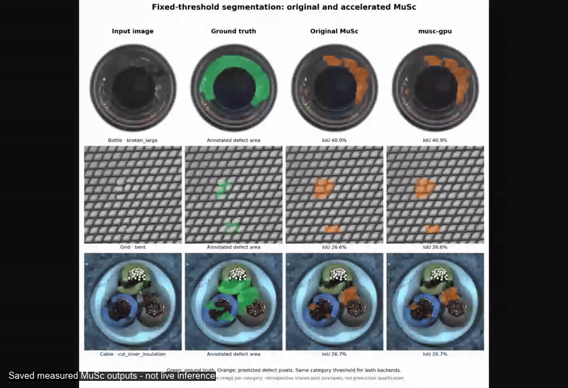
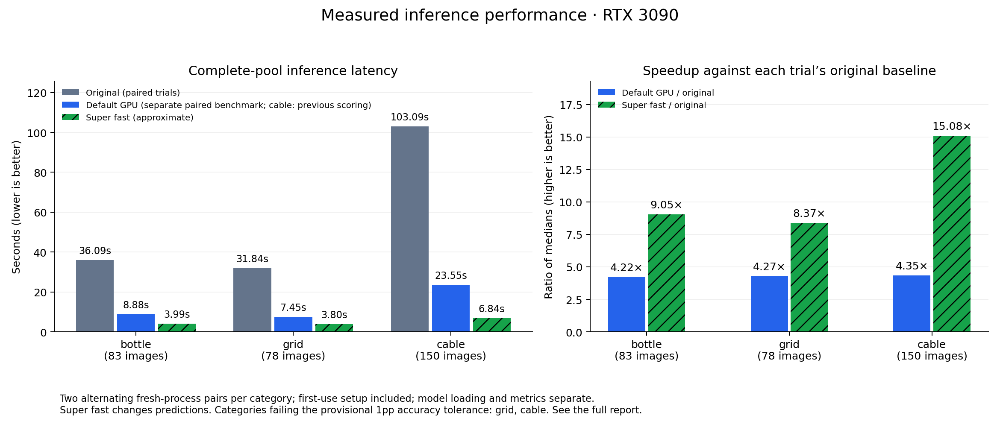
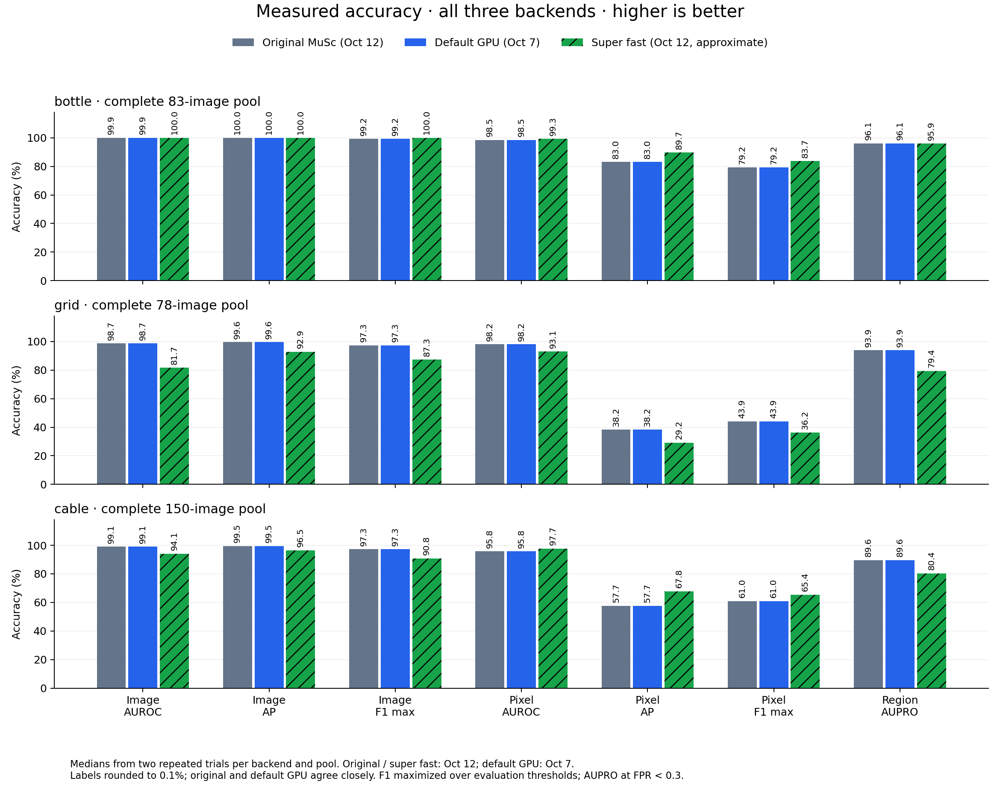
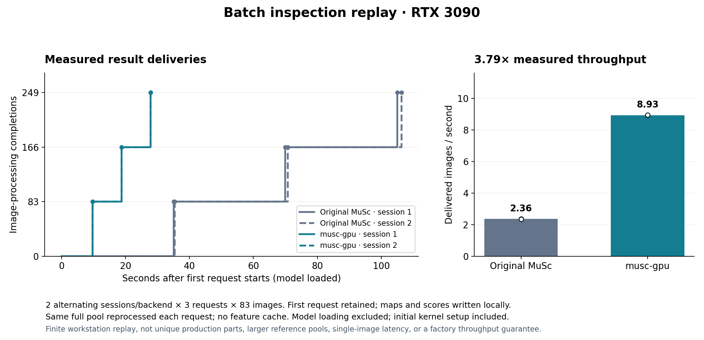
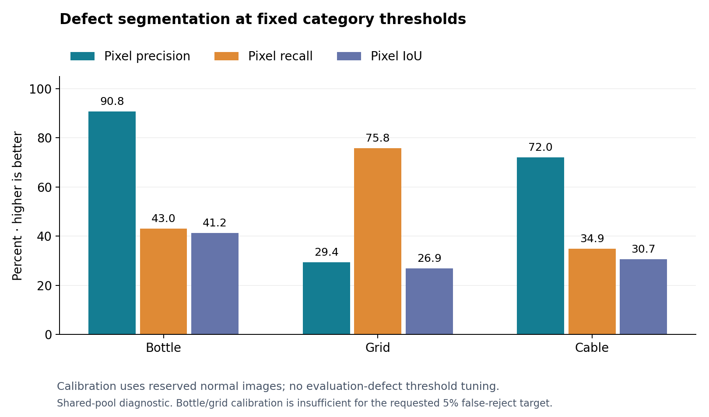
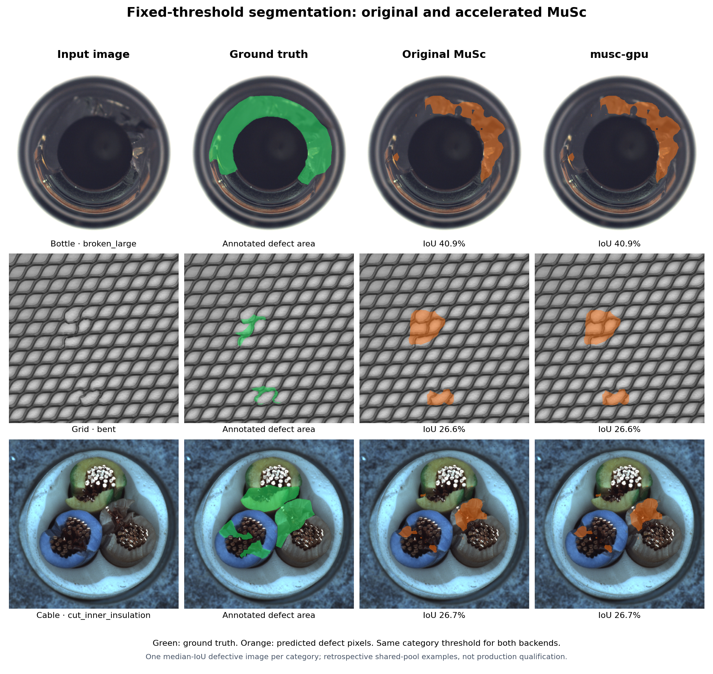
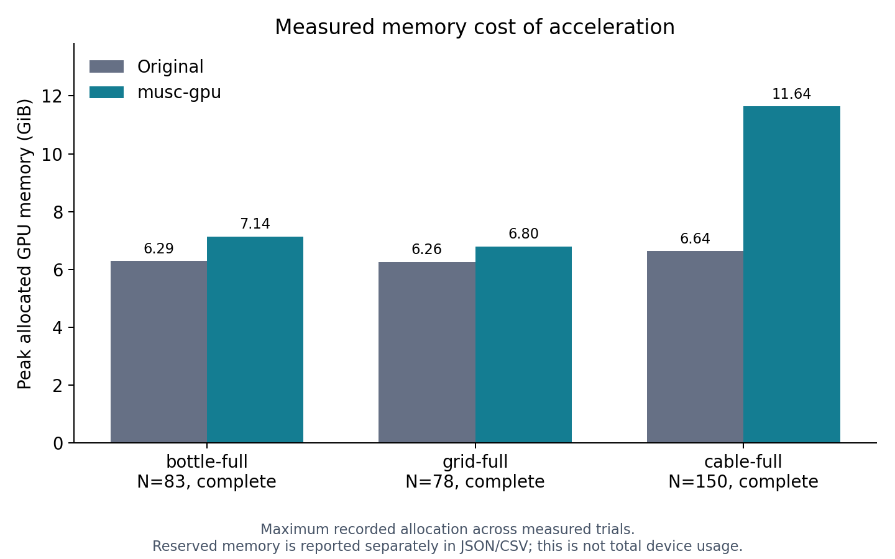
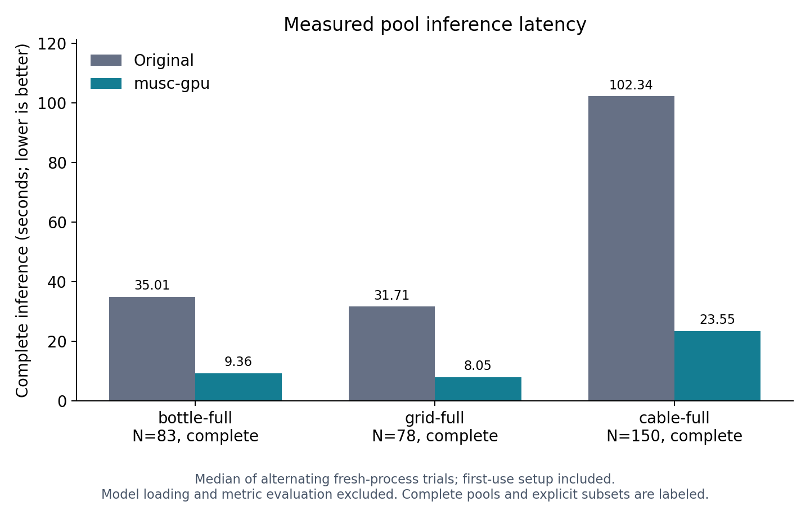
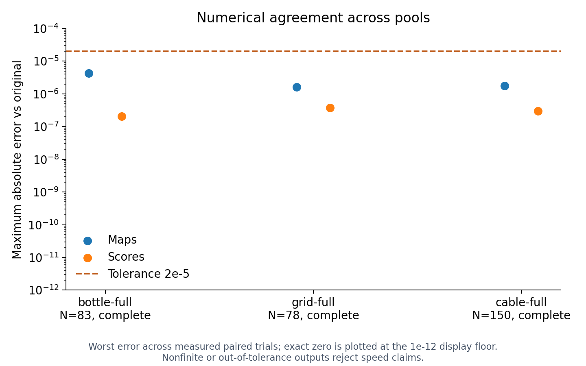

# musc-gpu

GPU-accelerated MuSc for zero-shot industrial anomaly detection and segmentation.



<sub>Recorded saved benchmark outputs; this is not live inference. [Recording details](media/DEMO.md).</sub>

[](https://github.com/DylanMartinLSC/musc-gpu/releases/latest/download/musc-gpu-python.zip)

Install the documented torch/torchvision pair first, then `python -m pip install <downloaded-wheel.whl>` and run `musc-gpu --help`. Model weights and datasets are separate. No EXE or PyPI publication is provided by this workflow.


**GPU-accelerated MuSc for zero-shot industrial anomaly detection and segmentation.**

Score a pool of unlabeled images and locate defects without task-specific training.
On an RTX 3090, the default GPU backend measures **4.22× (bottle) and 4.27×
(grid) faster inference** than original MuSc, with predictions within 2e-5 of
original. On cable the previous release measured 4.35×; the current scoring is a
further 1.16× faster there with bitwise identical outputs. Optional approximate
super fast measures **8.37–15.08×**, with substantial accuracy losses on grid and
cable. These measurements cover three complete MVTec AD category pools; see
[performance](#measured-performance).

[Quick start](#quick-start) · [Choose a backend](#choose-a-backend) ·
[Performance](#measured-performance) · [What changed](#changes-from-original-musc) ·
[Reproduce results](#reproduce-and-verify) ·
[Releases](https://github.com/DylanMartinLSC/musc-gpu/releases)

> **GPU acceleration requires native Windows and NVIDIA CUDA.** Linux, WSL and
> CPU select the original backend. Published results use CLIP ViT-L-14-336/OpenAI
> at 518 px.

Based on **MuSc (ICLR 2024)** by Xurui Li, Ziming Huang, Feng Xue and Yu Zhou.
See the [original repository](https://github.com/xrli-U/MuSc),
[paper](https://arxiv.org/abs/2401.16753) and
[attribution notices](THIRD_PARTY_NOTICES.md). This is an unofficial project.

## Quick start

Use PowerShell on native Windows with an NVIDIA GPU and a CUDA-compatible driver.
The measured package pair is **PyTorch 2.7.1 / torchvision 0.22.1, CUDA 11.8**.
Python 3.10 is a conservative setup choice, not a tested compatibility matrix.
See the [recorded package versions](benchmarks/representative/environment_packages.json).

```powershell
git clone https://github.com/DylanMartinLSC/musc-gpu.git
cd musc-gpu
python -m venv .venv
.venv/Scripts/python.exe -m pip install torch==2.7.1 torchvision==0.22.1 --index-url https://download.pytorch.org/whl/cu118
.venv/Scripts/python.exe -m pip install -r requirements.txt
```

Obtain MVTec AD separately and point `--data_path` at the directory containing
its category folders. Preserve the dataset layout, for example:

```text
mvtec_anomaly_detection/
└── bottle/
    ├── test/
    │   ├── good/
    │   └── broken_large/
    └── ground_truth/
        └── broken_large/
```

The tree shows only a few folders; keep the complete category test pool and
its ground-truth masks. The example evaluates that pool together: MuSc uses
other images as references, so changing the pool changes the task.

```powershell
.venv/Scripts/python.exe examples/musc_main.py --data_path C:/path/to/mvtec_anomaly_detection --class_name bottle --inference_backend gpu
```

The first model load downloads OpenAI weights if absent. The command prints
image-level and pixel-level evaluation metrics. Add `--vis true --save_excel true`
to save heatmaps and `results.xlsx` under `output/` (organized by dataset,
model and image size). Metrics and visualization run after inference; they
can add substantial time beyond the inference timings below.

Defaults are in [configs/musc.yaml](configs/musc.yaml). See [backend selection](#choose-a-backend)
for the original and super fast backends.

## Choose a backend

| Backend | Best use | Main tradeoff |
|---|---|---|
| `gpu` — default | Recommended for supported Windows/CUDA setups | Faster inference with more GPU memory; measured predictions agree with original within 2e-5 |
| `super_fast` | Speed-sensitive experiments with category-specific validation | Less GPU memory, but changes predictions and can substantially reduce accuracy |
| `original` | Reference implementation and unsupported platforms | Slowest measured inference |

The default GPU configuration uses batch size 4, one complete reference pool,
feature indices 5/11/17/23 and radii 1/3/5. No labels or masks enter anomaly
scoring; evaluation uses them.

### Optional super fast backend

```powershell
.venv/Scripts/python.exe examples/musc_main.py --data_path C:/path/to/mvtec_anomaly_detection --class_name bottle --inference_backend super_fast
```

Super fast overrides the feature selection with **layer `[5]` (zero-based)**,
**radius `[3]`** and a **28×28 scoring grid** instead of 37×37. It requires
ViT-L-14-336/OpenAI, 518 px, batch size 4 and one complete reference pool
(`divide_num=1`). All 24 encoder blocks still run for the pooled class features.
The printed configuration shows the effective settings.

It changes maps and scores, so evaluate your category and recalibrate thresholds
before use. Bottle meets the provisional accuracy tolerance in our trials;
**grid and cable do not**. See the [measurements below](#measured-performance)
and [full report](benchmarks/super_fast/CATEGORY_REPORT.md).

### Original backend and troubleshooting

```powershell
.venv/Scripts/python.exe examples/musc_main.py --data_path C:/path/to/mvtec_anomaly_detection --class_name bottle --inference_backend original
```

| Situation | What to do |
|---|---|
| Linux, WSL or CUDA unavailable | Accelerated requests select original and print a reason. Super fast retains the caller's original layer/radius settings in this fallback. |
| Missing NVRTC DLL or a Windows CUDA runtime error | Check the installation above, or explicitly select `original`. Runtime CUDA errors remain explicit. |
| Insufficient GPU memory | Check the [memory measurements](#memory-tradeoff) and allow headroom for reserved memory and other processes. |
| Different backbone, weights or resolution | Use `original` for configurations outside the supported acceleration settings. |

See [implementation details](docs/IMPLEMENTATION.md) for dispatch constraints
and runtime behavior.

## Measured performance

**RTX 3090; complete category pools; two alternating fresh-process pairs per
comparison.** Inference includes first-use compilation, decoding, preprocessing,
transfers, encoding, aggregation, scoring, interpolation and RsCIN. Model loading
and metric evaluation are separate. There is no discarded image warmup; OS
filesystem caches are not flushed.

### Inference speed

Default GPU versus original:

| Category | Images | Original median | Default GPU median | Speedup |
|---|---:|---:|---:|---:|
| bottle | 83 | 37.48 s | 8.88 s | **4.22×** |
| grid | 78 | 31.84 s | 7.45 s | **4.27×** |
| cable | 150 | 102.34 s | 23.55 s | **4.35×**¹ |

¹ Measured with the previous scoring module. The cable original-backend run did
not complete under the capped measurement job, so the current scoring was compared
GPU-only against the previous scoring: **1.16× faster** with bitwise identical maps
and scores. See the [scoring update report](benchmarks/rank_deferred/REPORT.md).

Super fast versus original, measured in a separate paired comparison:

| Category | Images | Original median | Super fast median | Speedup |
|---|---:|---:|---:|---:|
| bottle | 83 | 36.09 s | 3.99 s | **9.05×** |
| grid | 78 | 31.84 s | 3.81 s | **8.37×** |
| cable | 150 | 103.09 s | 6.84 s | **15.08×** |



Each speedup uses its own paired original baseline. For bottle and grid, default
GPU's ratio of summed category medians is **4.24×**. Super fast was re-measured
with the current scoring; all seven accuracy metrics are identical to the previous
release's. Results apply to these pools and this hardware; pool throughput is not
independent single-image latency.

### Accuracy

**Default GPU:** every full-resolution map and image score agrees with original
within **2e-5 absolute tolerance**. Maximum map errors are 4.315e-6 (bottle),
1.636e-6 (grid) and 1.738e-6 (cable; current scoring is bitwise identical to the
previous scoring measured there). This is numerical agreement, not bitwise
identity or an accuracy guarantee on other data.

**Super fast:** bottle meets a provisional limit of no more than one percentage
point (pp) loss across all seven metrics. Grid and cable fail it:

| Category | Image AUROC change | Pixel AP change | AUPRO change | Within provisional tolerance? |
|---|---:|---:|---:|---|
| bottle | +0.08 pp | +6.64 pp | −0.20 pp | Yes |
| grid | −17.04 pp | −9.07 pp | −14.53 pp | No |
| cable | −5.02 pp | +10.08 pp | −9.21 pp | No |

Changes are relative to original in the same pairs. The one-point limit is a
research screen, not a deployment acceptance criterion.



Original and super fast use the paired comparison; default GPU uses its separate
benchmark. The [original/default scorecards](benchmarks/representative/quality.png)
retain differences too small to see at this scale.

**Reading the metrics:** higher is better for all seven. Image metrics assess
whether a whole image is defective; pixel metrics assess defect localization.

| Metric | Meaning |
|---|---|
| Image AUROC | How well defective images rank above normal images across thresholds; 50% is random and 100% is perfect. |
| Image AP | Precision across recall levels for defective-image detection; useful when defects are rare. |
| Image F1 max | Best balance of image-level precision and recall at an evaluation-selected threshold. |
| Pixel AUROC | How well defective pixels rank above normal pixels; a high score can coexist with imperfect localization. |
| Pixel AP | Precision across recall levels for defective pixels, which are usually rare. |
| Pixel F1 max | Best balance of pixel-level precision and recall at an evaluation-selected threshold. |
| AUPRO | Defect-region coverage over low false-positive rates, weighting small and large regions equally. |

F1 max describes performance after threshold tuning, not performance at a fixed
production threshold. AUPRO here uses false-positive rates below 0.3.

### Memory tradeoff

The **default GPU backend uses more memory than original MuSc**; super fast uses
less in these trials. Measured peak allocated tensor memory:

| Category | Images | Original | Default GPU | Super fast |
|---|---:|---:|---:|---:|
| bottle | 83 | 6.29 GiB | 7.49 GiB | 3.47 GiB |
| grid | 78 | 6.26 GiB | 7.11 GiB | 3.35 GiB |
| cable | 150 | 6.64 GiB | 12.92 GiB² | 5.27 GiB |

² GPU-only scoring comparison; the previous scoring measured 11.64 GiB. Default
GPU bottle/grid and super fast figures are from the [scoring update](benchmarks/rank_deferred/REPORT.md).

These are tensor allocations, not total device usage or minimum VRAM requirements.
Reserved memory is reported separately; allow additional headroom. The current
scoring's per-pair bookkeeping grows with images² × patches (about +1.3 GiB at
150 images), so larger pools need their own capacity assessment.

[Scoring update report](benchmarks/rank_deferred/REPORT.md) ·
[Default GPU raw JSON](benchmarks/rank_deferred/results.json) ·
[Super fast raw JSON](benchmarks/rank_deferred/super_fast_results.json) ·
[Previous default GPU report](benchmarks/representative/REPORT.md) ·
[Previous super fast report](benchmarks/super_fast/CATEGORY_REPORT.md)

<details>
<summary>Additional diagnostics: batch throughput and fixed-threshold segmentation</summary>

These diagnostics were measured with the previous scoring module. Segmentation
uses the same predictions; throughput figures are conservative for the current
scoring.

### Batch inspection capacity

A resident-model replay measures **3.79× higher delivered throughput**:
**8.93 images/s** for musc-gpu versus **2.36 images/s** for original MuSc on
the RTX 3090. Each session processes three complete 83-image bottle pools,
recomputing every image. Delivering all 249 results takes **27.9 seconds**
with musc-gpu versus **105–106 seconds** with the original.



Two alternating sessions per backend include first-use kernel setup and local
score/map output writing; model loading is separate. All requests pass the
2e-5 numerical agreement gate. This is a **finite workstation replay of the
same pool**, not distinct production parts, a larger single reference pool,
or measured factory-line capacity. See the [protocol](docs/DEPLOYMENT_BENCHMARK.md)
and [results](benchmarks/deployment/REPORT.md).

### Segmentation at a fixed threshold

On saved GPU predictions, thresholds calibrated on reserved normal images give
the pixel precision, recall and intersection-over-union (IoU) below. Bottle and
cable have relatively precise masks but miss substantial defect area; grid has
higher recall with more excess segmentation. Normal-image false alarms were
**0/10** (bottle), **2/11** (grid) and **0/29** (cable).



The examples below compare input images, ground truth (green), and original/default GPU
predictions (orange) at the **same fixed category threshold**. Each category uses
its median-IoU defective evaluation image, rather than a hand-picked best case.
The near-identical backend outputs preserve the same segmentation limitations.



Example imagery: MVTec AD, MVTec Software GmbH; adapted under
[CC BY-NC-SA 4.0](https://creativecommons.org/licenses/by-nc-sa/4.0/).
See [image attribution](THIRD_PARTY_NOTICES.md#mvtec-ad-example-figure).

These are **retrospective, shared-pool diagnostics**, not production qualification.
Bottle and grid had only 10 normal calibration images each, insufficient for the
requested 5% false-reject operating point; their thresholds use the calibration
maximum for diagnosis only. No threshold was tuned on evaluation defects.
See the [protocol](docs/SEGMENTATION_USEFULNESS.md) and
[measured results](benchmarks/segmentation_usefulness/results.json) for counts,
thresholds, region coverage and limitations.

</details>

<details>
<summary>More charts: memory, absolute latency and numerical agreement</summary>





</details>

## Changes from original MuSc

The default GPU backend accelerates scoring, pooling, loading and attention
while preserving the reference configuration. Super fast additionally changes
feature selection and patch aggregation, as described [above](#optional-super-fast-backend).

<details>
<summary>How the default GPU optimizations work</summary>

The default `gpu` acceleration changes how inference is executed. It preserves the model
weights, input resolution, selected feature layers, aggregation radii and
complete reference pool used in the comparison.

- **GPU mutual scoring:** replaces repeated per-image distance calculations
  with tiled GPU matrix multiplications. Symmetric tiles serve both image
  directions, avoiding duplicate dot products. Error bounds screen candidates;
  distances that can determine a minimum are refined using the original FP32
  features. Per-reference-image Euclidean minima, self exclusion and trimmed
  ranks are preserved, with FP64 score outputs.
- **Trimmed-rank deferred refinement:** each patch score averages only its
  smallest per-image minima (24 of 82 for an 83-image pool). Exact FP32 work
  is therefore deferred until every pair has certified bounds: pairs and
  candidate patches that provably cannot enter the selected ranks are skipped,
  and the selected values, hence scores and maps, are bitwise identical to
  refining every pair. Reverse-direction screening reads tiles coalesced, and
  only the kernels used by the supported shape are compiled.
- **Direct neighborhood pooling:** replaces expanded `Unfold` neighborhoods
  and their subsequent averaging with spatial average pooling for supported
  shapes. This avoids materializing large intermediate tensors while preserving
  normalization and zero-padding behavior.
- **Normalization reuse across radii:** computes the shared spatial
  normalization once per feature tensor and reuses it for radii 1, 3 and 5
  within an inference division. The cache is cleared between divisions;
  image features are recomputed on every inference call.
- **Fewer CPU/GPU transfers:** keeps patch features, aggregated features and
  intermediate anomaly maps on the GPU through aggregation and scoring,
  instead of repeatedly moving them to the CPU and back. This trades higher
  GPU memory use for less transfer overhead.
- **Ordered parallel image loading:** uses four loading threads with bounded
  prefetching to overlap decoding and preprocessing. Dataset order and
  batch size 4 assembly are preserved.
- **Specialized attention softmax:** uses an alignment-aware CUDA kernel for
  the supported CLIP attention shape. It preserves FP32 softmax arithmetic
  and the FP16 probabilities consumed by attention, reuses the FP16 result,
  and omits discarded FP32 probability stores in 23 of 24 transformer blocks.
  Block 12 retains both outputs because its attention weights are used later.

</details>

See [implementation details](docs/IMPLEMENTATION.md) for numerical safeguards,
supported shapes and verification.

## Reproduce and verify

Run the original/default GPU comparison from the repository root. Use a **new output
directory** for each run and an exclusive GPU slot. Allow several GiB of disk
space for prediction arrays. The benchmark has a fixed backbone/configuration;
editing `configs/musc.yaml` does not change it.

```powershell
.venv/Scripts/python.exe tools/benchmark.py --data-path C:/path/to/mvtec_anomaly_detection --plan-only
.venv/Scripts/python.exe tools/benchmark.py --data-path C:/path/to/mvtec_anomaly_detection --categories bottle grid cable --pairs 2 --include-pro --output benchmarks/runs/representative
```

To compare original and super fast on the same complete pools:

```powershell
.venv/Scripts/python.exe tools/benchmark_super_fast.py --data-path C:/path/to/mvtec_anomaly_detection --categories bottle grid cable --output benchmarks/runs/super_fast
```

Both comparisons record inference time, accuracy, memory and repeated predictions.
The super fast comparison allows changed predictions and reports accuracy losses.

See the [benchmark guide](docs/BENCHMARK.md) for timing boundaries, report
commands, smaller-pool tests, capacity checks and failure handling.
`--categories all` requests all 15 categories; only successful complete-pool
runs support category-level claims.

Check release integrity without weights, torch imports or CUDA trials:

```powershell
.venv/Scripts/python.exe tools/verify_release.py
.venv/Scripts/python.exe tools/test_benchmark.py
```

## Project guide

| Resource | Contents |
|---|---|
| [Implementation and verification](docs/IMPLEMENTATION.md) | GPU scoring, pooling, loading, normalization reuse, attention and historical qualification |
| [Benchmark protocol](docs/BENCHMARK.md) | Reproducible comparisons, timing scope and numerical gates |
| [Scoring update results](benchmarks/rank_deferred/REPORT.md) | Trimmed-rank deferred scoring: bottle/grid original pairs, cable bitwise GPU comparison, memory |
| [Representative results](benchmarks/representative/REPORT.md) | Previous-scoring speed, quality and memory for three complete pools |
| [Super fast paired results](benchmarks/super_fast/CATEGORY_REPORT.md) | Twelve complete-pool calls; speed, memory, all seven accuracy metrics and repeatability |
| [Source manifest](SOURCE_MANIFEST.json) | Packaged source and evidence hashes |
| [Issue tracker](https://github.com/DylanMartinLSC/musc-gpu/issues) | Bug reports and feature requests |

For a useful bug report, include the command, OS, GPU/VRAM, Python and
PyTorch/CUDA versions, backend, category/pool size and full error message.
For benchmark discrepancies, include the result JSON and timing scope.

## Citation and license

Please cite the original MuSc paper when using its method:

```bibtex
@inproceedings{li2024musc,
  title={MuSc: Zero-Shot Industrial Anomaly Classification and Segmentation with Mutual Scoring of the Unlabeled Images},
  author={Li, Xurui and Huang, Ziming and Xue, Feng and Zhou, Yu},
  booktitle={International Conference on Learning Representations},
  year={2024}
}
```

Preserved MuSc [MIT license](LICENSE). Bundled third-party sources retain their
applicable licenses; see [THIRD_PARTY_NOTICES.md](THIRD_PARTY_NOTICES.md).
