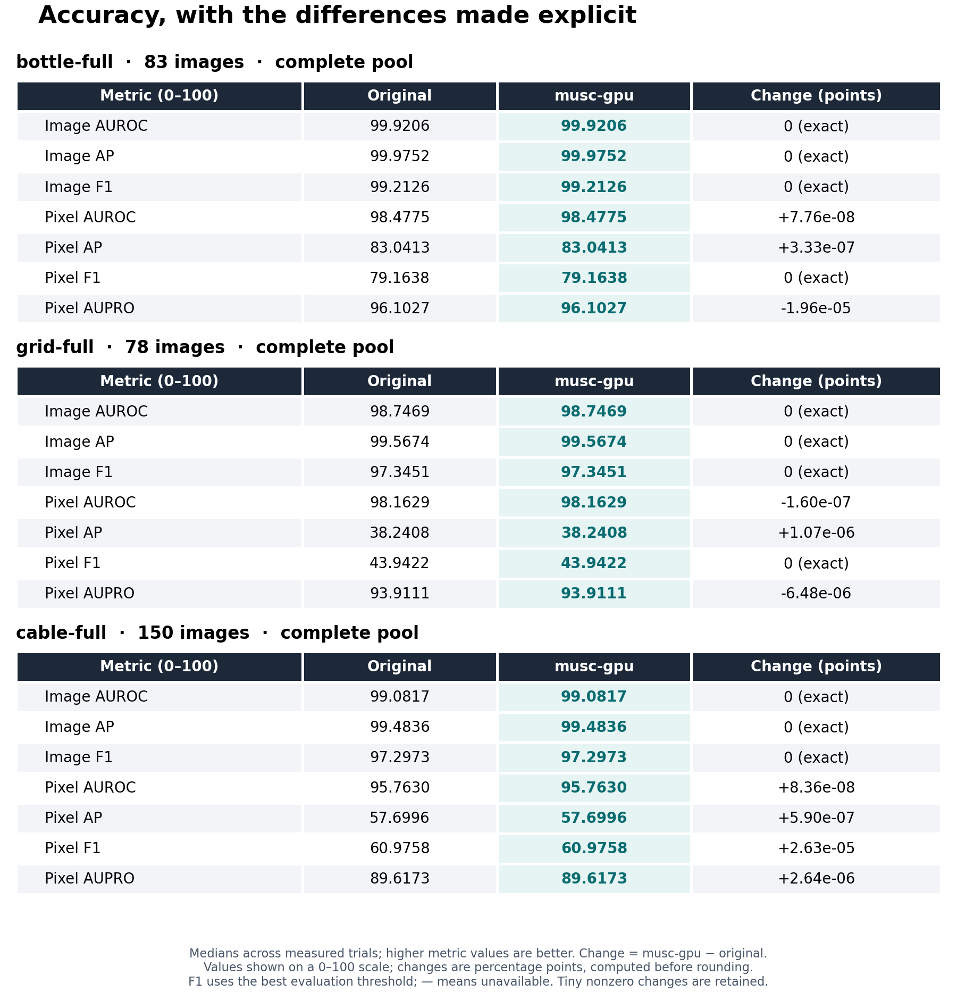

# musc-gpu

**GPU-accelerated MuSc for zero-shot industrial anomaly detection and segmentation.**

Score a pool of unlabeled images and locate anomalies without task-specific
training. On an NVIDIA RTX 3090, the default backend measures **3.74–4.35×
faster complete-pool inference** than original MuSc on MVTec AD bottle, grid
and cable. The optional approximate **`super_fast` backend measures a further
2.63–2.70× speedup over default GPU on bottle83**, reaching a **3.49 s median**.
Its fresh paired speedup against original MuSc is still pending; the historical
original bottle83 median is **35.01 s** under a different timing protocol.
See [measured performance](#measured-performance) for scope and accuracy tradeoffs.
The original backend remains selectable.

[Quick start](#quick-start) · [What changed](#changes-from-original-musc) ·
[Benchmarks](#measured-performance) ·
[Implementation](docs/IMPLEMENTATION.md) · [Reproduce results](docs/BENCHMARK.md) ·
[Releases](https://github.com/DylanMartinLSC/musc-gpu/releases)

> **Accelerated platform: native Windows + NVIDIA CUDA.** Published results use
> CLIP ViT-L-14-336/OpenAI at 518px. Linux, WSL and CPU select the original
> backend; accelerated kernels are not implemented for those platforms.

Based on **MuSc (ICLR 2024)** by Xurui Li, Ziming Huang, Feng Xue and Yu Zhou.
See the [original repository](https://github.com/xrli-U/MuSc),
[paper](https://arxiv.org/abs/2401.16753) and
[attribution notices](THIRD_PARTY_NOTICES.md). This is an unofficial project.

## Changes from original MuSc

The default `gpu` acceleration changes how inference is executed. It preserves the model
weights, input resolution, selected feature layers, aggregation radii and
complete reference pool used in the comparison.

- **GPU mutual scoring:** replaces repeated per-image distance calculations
  with tiled GPU matrix multiplications. Symmetric tiles serve both image
  directions, avoiding duplicate dot products. Error bounds screen candidates;
  distances that can determine a minimum are refined using the original FP32
  features. Per-reference-image Euclidean minima, self exclusion and trimmed
  ranks are preserved, with FP64 score outputs.
- **Direct neighborhood pooling:** replaces expanded `Unfold` neighborhoods
  and their subsequent averaging with spatial average pooling for supported
  shapes. This avoids materializing large intermediate tensors while preserving
  normalization and zero-padding behavior.
- **Normalization reuse across radii:** computes the shared spatial
  normalization once per feature tensor and reuses it for radii 1, 3 and 5
  within an inference division. The cache is cleared between divisions;
  image features are recomputed on every inference call.
- **Fewer CPU/GPU transfers:** keeps patch features, aggregated features and
  intermediate anomaly maps on the GPU through aggregation and scoring,
  instead of repeatedly moving them to the CPU and back. This trades higher
  GPU memory use for less transfer overhead.
- **Ordered parallel image loading:** uses four loading threads with bounded
  prefetching to overlap decoding and preprocessing. Dataset order and
  batch-size-4 assembly are preserved.
- **Specialized attention softmax:** uses an alignment-aware CUDA kernel for
  the supported CLIP attention shape. It preserves FP32 softmax arithmetic
  and the FP16 probabilities consumed by attention, reuses the FP16 result,
  and omits discarded FP32 probability stores in 23 of 24 transformer blocks.
  Block 12 retains both outputs because its attention weights are used later.

The original backend remains selectable. The measured predictions agree
within the **2e-5 full-image tolerance**; this is not a claim of bitwise
identity. The reported speedups measure the combined pipeline, not separate
speedup claims for each change. See [implementation details](docs/IMPLEMENTATION.md)
for dispatch constraints, numerical safeguards and verification.

## Quick start

Use PowerShell on native Windows with an NVIDIA GPU and a CUDA-compatible driver.
The measured package pair is **PyTorch 2.7.1 / torchvision 0.22.1, CUDA 11.8**.
Python 3.10 is a conservative setup choice, not a tested compatibility matrix.
See the [recorded package versions](benchmarks/representative/environment_packages.json).

```powershell
git clone https://github.com/DylanMartinLSC/musc-gpu.git
cd musc-gpu
python -m venv .venv
.venv/Scripts/python.exe -m pip install torch==2.7.1 torchvision==0.22.1 --index-url https://download.pytorch.org/whl/cu118
.venv/Scripts/python.exe -m pip install -r requirements.txt
```

Obtain MVTec AD separately and point `--data_path` at the directory containing
its category folders. Preserve the dataset layout, for example:

```text
mvtec_anomaly_detection/
└── bottle/
    ├── test/
    │   ├── good/
    │   └── broken_large/
    └── ground_truth/
        └── broken_large/
```

The tree shows only a few folders; keep the complete category test pool and
its ground-truth masks. The example evaluates that pool together: MuSc uses
other images as references, so changing the pool changes the task.

```powershell
.venv/Scripts/python.exe examples/musc_main.py --data_path C:/path/to/mvtec_anomaly_detection --class_name bottle --inference_backend gpu
```

The first model load downloads OpenAI weights if absent. The command prints
image-level and pixel-level evaluation metrics. Add `--vis true --save_excel true`
to save heatmaps and `results.xlsx` under `output/` (organized by dataset,
model and image size). Metrics and visualization run after inference; they
can add substantial time beyond the inference timings below.

Defaults are in [configs/musc.yaml](configs/musc.yaml). The published comparison
uses batch size 4, one complete reference pool, feature indices 5/11/17/23 and
radii 1/3/5. No labels or masks enter anomaly scoring; evaluation uses them.

### Optional super fast backend

```powershell
.venv/Scripts/python.exe examples/musc_main.py --data_path C:/path/to/mvtec_anomaly_detection --class_name bottle --inference_backend super_fast
```

`super_fast` selects an **approximate preset**: feature layer `[5]` (zero-based),
`r_list=[3]`, and a **28×28 scoring grid** instead of 37×37. It retains the 518px
encoder and the complete image/reference pool. The preset overrides feature-layer
and radius settings; the printed effective configuration shows `[5]` and `[3]`.
The default remains `gpu`.

On the complete bottle83 pool, two research passes measured **3.61s / 3.37s**
(median **3.49s**) versus default GPU **9.50s / 9.11s**: within-sweep gains of
**2.63× / 2.70× over default GPU**. Image AUROC was 100%, pixel AUROC 99.28%,
pixel AP 89.68%, and region AUPRO 95.91%. Region AUPRO fell 0.20 percentage
points versus default; the other measured metrics improved. Peak allocated
memory fell from **7.14 GiB to 3.17 GiB** in those profile trials.
Packaged dispatch was separately checked against those saved predictions.
See [super fast evidence and limits](benchmarks/super_fast/REPORT.md).


The report also includes historical original MuSc measurements: **35.01s**,
**6.29 GiB** peak allocated memory, pixel AP **83.04%** and region AUPRO
**96.10%**. Original and super-fast timings came from separate runs and timing
protocols. **A fresh paired original/super-fast comparison is still pending**:
the attempted run was blocked by process-inventory and model-check permissions.
No paired original-relative or exact-contract 10× claim is made.

These results apply to **bottle83 on the RTX 3090**. This mode changes maps/scores
and does not preserve the default 2e-5 numerical agreement contract; evaluate
your category and recalibrate thresholds before using it. The configuration
requires ViT-L-14-336/OpenAI, 518px, batch4 and one complete reference pool
(`divide_num=1`). All 24 encoder blocks still run for the pooled class features.
On unsupported platforms or without CUDA, it selects the original backend with
the caller's original layer/radius settings. Runtime CUDA errors remain explicit.

To reproduce the fresh-process original/super-fast comparison with normal
benchmark permissions, use a new output directory:

```powershell
.venv/Scripts/python.exe tools/benchmark_super_fast.py --data-path C:/path/to/mvtec_anomaly_detection --output output/super_fast_comparison
```

This runs two alternating pairs on bottle83, recording full-resolution accuracy,
peak allocated/reserved memory, first-use setup and repeatability. It retains
process/model checks and does not apply the exact-output gate to this approximate
profile. Model loading and metric evaluation are reported separately.

### Original backend and troubleshooting

To run the numerical reference implementation:

```powershell
.venv/Scripts/python.exe examples/musc_main.py --data_path C:/path/to/mvtec_anomaly_detection --class_name bottle --inference_backend original
```

| Situation | What to do |
|---|---|
| Linux, WSL or CUDA unavailable | The GPU request selects the original backend and prints a reason. These paths are not performance-qualified here. |
| Missing NVRTC DLL or a Windows CUDA runtime error | Check the PyTorch/CUDA installation above, or explicitly use `--inference_backend original`. Runtime errors do not silently fall back. |
| Insufficient GPU memory | Check the measured peaks below and leave room for reserved memory and other processes. Larger pools need a separate capacity assessment. |
| Different backbone, weights or resolution | Use the original backend for unvalidated configurations; published speedups apply only to the stated configuration. |

The custom runtime loads NVRTC DLLs supplied with Windows PyTorch and uses the
caller's CUDA stream. The attention wrapper uses native PyTorch outside its
supported dispatch. See [implementation details](docs/IMPLEMENTATION.md).

## Measured performance

**Complete category pools, RTX 3090, two alternating original/GPU pairs.** Each
pass starts in a fresh process and includes first-use compilation, decoding,
preprocessing, transfers, encoding, aggregation, scoring, interpolation and
RsCIN. Model loading and metrics are measured separately. There is no discarded
image warmup; OS filesystem caches are not flushed.

| Category | Images | Original median | musc-gpu median | Speedup | GPU peak allocated |
|---|---:|---:|---:|---:|---:|
| bottle | 83 | 35.01 s | 9.36 s | **3.74×** | 7.14 GiB |
| grid | 78 | 31.71 s | 8.05 s | **3.94×** | 6.80 GiB |
| cable | 150 | 102.34 s | 23.55 s | **4.35×** | 11.64 GiB |

**Optional `super_fast` (approximate, bottle83 only):** two resident-model
research sweeps measured **3.61 / 3.37 s**, median **3.49 s**, versus default
GPU **9.50 / 9.11 s** in the same sweeps: **2.63–2.70× faster**. Peak allocated
memory fell from **7.14 to 3.17 GiB**. Pixel AP increased **6.64 percentage
points** and AUPRO decreased **0.20 points**. These Oct 12 profile sweeps use
a different process/setup protocol from the Oct 7 original/GPU pairs above;
a fresh paired comparison against original MuSc remains pending. Super fast
does not preserve the numerical agreement contract below, and grid/cable
have not been tested with this preset. See the [option](#optional-super-fast-backend)
and [full report](benchmarks/super_fast/REPORT.md).


The ratio of summed category medians is **4.13×**. This covers these three
categories, not all of MVTec AD or other GPUs/backbones. Pool throughput is
not independent single-image latency.

**Original versus default GPU numerical agreement:** every full-resolution map and image score passes the
**2e-5 absolute tolerance**. Maximum map errors are 4.315e-6 (bottle), 1.636e-6
(grid) and 1.738e-6 (cable). Image AUROC/AP/F1 agree in these runs; pixel
AUROC/AP/F1/AUPRO remain close, with exact deltas in the raw JSON. Agreement
within tolerance does not imply bitwise identity or accuracy guarantees elsewhere.

The scorecards show both backends on a 0–100 scale and the signed change in
percentage points, including differences too small to see on a conventional plot.



### Batch inspection capacity

A resident-model replay measures **3.79× higher delivered throughput**:
**8.93 images/s** for musc-gpu versus **2.36 images/s** for original MuSc on
the RTX 3090. Each session processes three complete 83-image bottle pools,
recomputing every image. Delivering all 249 results takes **27.9 seconds**
with musc-gpu versus **105–106 seconds** with the original.


Two alternating sessions per backend include first-use kernel setup and local
score/map output writing; model loading is separate. All requests pass the
2e-5 numerical agreement gate. This is a **finite workstation replay of the
same pool**, not distinct production parts, a larger single reference pool,
or measured factory-line capacity. See the [protocol](docs/DEPLOYMENT_BENCHMARK.md)
and [results](benchmarks/deployment/REPORT.md).

### Segmentation at a fixed threshold

On saved GPU predictions, thresholds calibrated on reserved normal images give
the pixel precision, recall and intersection-over-union (IoU) below. Bottle and
cable have relatively precise masks but miss substantial defect area; grid has
higher recall with more excess segmentation. Normal-image false alarms were
**0/10** (bottle), **2/11** (grid) and **0/29** (cable).


The examples below compare input images, ground truth (green), and original/GPU
predictions (orange) at the **same fixed category threshold**. Each category uses
its median-IoU defective evaluation image, rather than a hand-picked best case.
The near-identical backend outputs preserve the same segmentation limitations.


Example imagery: MVTec AD, MVTec Software GmbH; adapted under
[CC BY-NC-SA 4.0](https://creativecommons.org/licenses/by-nc-sa/4.0/).
See [image attribution](THIRD_PARTY_NOTICES.md#mvtec-ad-example-figure).

These are **retrospective, shared-pool diagnostics**, not production qualification.
Bottle and grid had only 10 normal calibration images each, insufficient for the
requested 5% false-reject operating point; their thresholds use the calibration
maximum for diagnosis only. No threshold was tuned on evaluation defects.
See the [protocol](docs/SEGMENTATION_USEFULNESS.md) and
[measured results](benchmarks/segmentation_usefulness/results.json) for counts,
thresholds, region coverage and limitations.

### Memory tradeoff

Acceleration uses more GPU memory. The chart below compares the maximum
allocated tensor memory across measured trials for each complete category pool:
**bottle: 6.29 → 7.14 GiB**, **grid: 6.26 → 6.80 GiB**, and
**cable: 6.64 → 11.64 GiB** (original → musc-gpu).


These are peak tensor allocations, not total device usage or minimum VRAM
requirements. Reserved GPU memory is recorded separately in the linked JSON
and CSV; allow additional headroom when assessing capacity.

[Full report](benchmarks/representative/REPORT.md) ·
[Raw JSON](benchmarks/representative/results.json) ·
[CSV](benchmarks/representative/summary.csv)

<details>
<summary>More charts: absolute latency and numerical agreement</summary>


</details>

## Reproduce and verify

Run the complete comparison from the repository root. Use a **new output
directory** for each run and an exclusive GPU slot. Allow several GiB of disk
space for prediction arrays. The benchmark has a fixed backbone/configuration;
editing `configs/musc.yaml` does not change it.

```powershell
.venv/Scripts/python.exe tools/benchmark.py --data-path C:/path/to/mvtec_anomaly_detection --plan-only
.venv/Scripts/python.exe tools/benchmark.py --data-path C:/path/to/mvtec_anomaly_detection --categories bottle grid cable --pairs 2 --include-pro --output benchmarks/runs/representative
```

See the [benchmark guide](docs/BENCHMARK.md) for timing boundaries, report
commands, smaller-pool tests, capacity checks and failure handling.
`--categories all` requests all 15 categories; only successful complete-pool
runs support category-level claims.

Check release integrity without weights, torch imports or CUDA trials:

```powershell
.venv/Scripts/python.exe tools/verify_release.py
.venv/Scripts/python.exe tools/test_benchmark.py
```

## Project guide

| Resource | Contents |
|---|---|
| [Implementation and verification](docs/IMPLEMENTATION.md) | GPU scoring, pooling, loading, normalization reuse, attention and historical qualification |
| [Benchmark protocol](docs/BENCHMARK.md) | Reproducible comparisons, timing scope and numerical gates |
| [Representative results](benchmarks/representative/REPORT.md) | Measured speed, quality and memory for three complete pools |
| [Source manifest](SOURCE_MANIFEST.json) | Packaged source and evidence hashes |
| [Issue tracker](https://github.com/DylanMartinLSC/musc-gpu/issues) | Bug reports and feature requests |

For a useful bug report, include the command, OS, GPU/VRAM, Python and
PyTorch/CUDA versions, backend, category/pool size and full error message.
For benchmark discrepancies, include the result JSON and timing scope.

## Citation and license

Please cite the original MuSc paper when using its method:

```bibtex
@inproceedings{li2024musc,
  title={MuSc: Zero-Shot Industrial Anomaly Classification and Segmentation with Mutual Scoring of the Unlabeled Images},
  author={Li, Xurui and Huang, Ziming and Xue, Feng and Zhou, Yu},
  booktitle={International Conference on Learning Representations},
  year={2024}
}
```

Preserved MuSc [MIT license](LICENSE). Bundled third-party sources retain their
applicable licenses; see [THIRD_PARTY_NOTICES.md](THIRD_PARTY_NOTICES.md).
