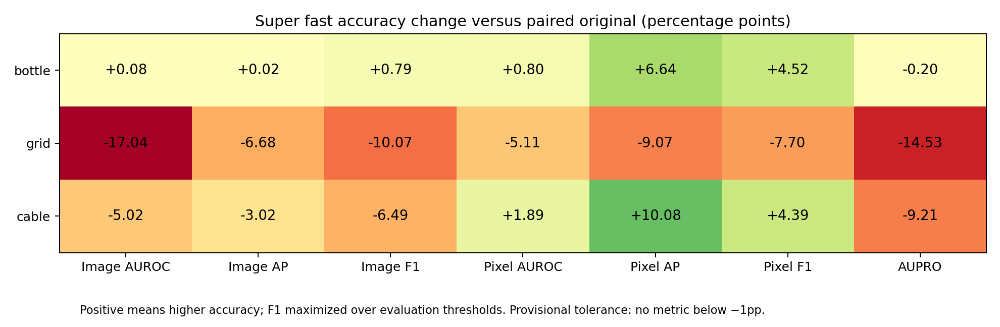

# Super fast: complete category measurements

Two alternating fresh-process original/super-fast pairs on each complete bottle83, grid78 and cable150 pool, measured 2026-10-12. **12 full inference calls completed.**

**Verdict:** super fast is substantially faster and uses less allocated GPU memory. Only bottle meets the provisional one-percentage-point loss limit across all seven metrics. Grid and cable fail it. The preset is approximate and does not preserve the original numerical contract.

[Authoritative paired JSON](category_results.json). Historical [bottle profile selection and implementation report](REPORT.md) is retained separately.

## Inference speed and GPU memory

| Complete pool | Original median | Super fast median | Median speedup | Individual pair speedups | Original / fast allocated GiB | Original / fast reserved GiB |
|---|---:|---:|---:|---|---:|---:|
| bottle (83) | 36.580s | 4.304s | **8.499×** | 8.258× / 8.773× | 6.292 / 3.167 | 7.611 / 3.641 |
| grid (78) | 31.908s | 3.786s | **8.428×** | 8.439× / 8.416× | 6.263 / 3.071 | 7.518 / 3.625 |
| cable (150) | 103.715s | 6.915s | **15.000×** | 14.997× / 15.002× | 6.639 / 4.445 | 10.740 / 4.943 |

Speedup is the ratio of the two measured medians for that category. Allocated/reserved columns are medians of per-call peaks, including resident model tensors. Reserved memory is not the same as active tensor memory or total board usage.


The blue default-GPU bars come from the separate Oct 7 original/default benchmark. Each speedup uses its own paired original baseline; no cross-run default-versus-super-fast ratio is claimed.

## Accuracy tradeoffs

Metric values are percentages; deltas are percentage points relative to the original backend in these same pairs. F1 is maximized over evaluation thresholds; no production decision threshold is established. Region AUPRO uses the upstream 200 global thresholds and FPR below 0.3, evaluated by exact sorted searches. Its CPU preflight agrees with upstream to below 1e-12. Labels and masks are only used after inference for evaluation.



### bottle (83 images)

| Metric | Original | Super fast | Change (pp) |
|---|---:|---:|---:|
| Image AUROC | 99.9206% | 100.0000% | +0.0794 |
| Image AP | 99.9752% | 100.0000% | +0.0248 |
| Image F1 max | 99.2126% | 100.0000% | +0.7874 |
| Pixel AUROC | 98.4775% | 99.2819% | +0.8045 |
| Pixel AP | 83.0413% | 89.6834% | +6.6421 |
| Pixel F1 max | 79.1638% | 83.6851% | +4.5214 |
| Pixel AUPRO | 96.1027% | 95.9052% | -0.1976 |

Provisional ≤1pp loss across every metric: **PASS**.
The one-percentage-point limit is a research screen, not a user-approved deployment tolerance.

### grid (78 images)

| Metric | Original | Super fast | Change (pp) |
|---|---:|---:|---:|
| Image AUROC | 98.7469% | 81.7043% | -17.0426 |
| Image AP | 99.5674% | 92.8900% | -6.6774 |
| Image F1 max | 97.3451% | 87.2727% | -10.0724 |
| Pixel AUROC | 98.1629% | 93.0518% | -5.1112 |
| Pixel AP | 38.2408% | 29.1695% | -9.0713 |
| Pixel F1 max | 43.9422% | 36.2444% | -7.6978 |
| Pixel AUPRO | 93.9111% | 79.3844% | -14.5267 |

Provisional ≤1pp loss across every metric: **FAIL**.
The one-percentage-point limit is a research screen, not a user-approved deployment tolerance.

### cable (150 images)

| Metric | Original | Super fast | Change (pp) |
|---|---:|---:|---:|
| Image AUROC | 99.0817% | 94.0592% | -5.0225 |
| Image AP | 99.4836% | 96.4588% | -3.0248 |
| Image F1 max | 97.2973% | 90.8108% | -6.4865 |
| Pixel AUROC | 95.7630% | 97.6567% | +1.8937 |
| Pixel AP | 57.6996% | 67.7758% | +10.0762 |
| Pixel F1 max | 60.9758% | 65.3693% | +4.3935 |
| Pixel AUPRO | 89.6173% | 80.4067% | -9.2107 |

Provisional ≤1pp loss across every metric: **FAIL**.
The one-percentage-point limit is a research screen, not a user-approved deployment tolerance.

## Individual calls and separate setup/metric timing

| Pool | Pair | Backend | Inference | Model load | CUDA setup | Metrics | Peak allocated MiB | Peak reserved MiB |
|---|---:|---|---:|---:|---:|---:|---:|---:|
| bottle | 1 | original | 37.789781s | 6.114179s | 0.157602s | 15.638161s | 6443.120 | 7794.000 |
| bottle | 1 | super_fast | 4.576343s | 5.259990s | 0.121649s | 15.163148s | 3242.852 | 3728.000 |
| bottle | 2 | super_fast | 4.031384s | 3.994647s | 0.077513s | 10.666319s | 3242.852 | 3728.000 |
| bottle | 2 | original | 35.369234s | 3.995917s | 0.073688s | 10.770228s | 6443.120 | 7794.000 |
| grid | 1 | original | 31.932334s | 3.938083s | 0.074351s | 10.958791s | 6413.508 | 7698.000 |
| grid | 1 | super_fast | 3.783811s | 3.986914s | 0.073956s | 10.379233s | 3144.554 | 3712.000 |
| grid | 2 | super_fast | 3.788485s | 4.018489s | 0.079787s | 10.333649s | 3144.554 | 3712.000 |
| grid | 2 | original | 31.884169s | 3.972943s | 0.079453s | 10.980135s | 6413.508 | 7698.000 |
| cable | 1 | original | 103.836713s | 4.025538s | 0.084532s | 21.810159s | 6798.575 | 10998.000 |
| cable | 1 | super_fast | 6.923808s | 3.989656s | 0.074073s | 20.786487s | 4551.609 | 5062.000 |
| cable | 2 | super_fast | 6.905354s | 3.991230s | 0.079266s | 20.874545s | 4551.609 | 5062.000 |
| cable | 2 | original | 103.593993s | 3.976701s | 0.077098s | 21.921045s | 6798.575 | 10998.000 |

## Executed protocol, dispatch and repeatability

MuSc.make_category_data entry through synchronized pre-metric predictions; includes loading, decoding, preprocessing, transfers, encoding, aggregation, scoring, interpolation, RsCIN and first-use compilation; excludes imports, model loading, metric evaluation and artifact serialization.

Order per category: original → super fast, then super fast → original. Every call has a fresh child process, resident weights loaded before inference, no discarded image warmup, and no image features cached across calls. OS filesystem caches are not flushed. Categories remain separate complete reference pools; no subset, survivor cap or reference split is used.

Public MuSc constructor selects `super_fast`; the effective configuration is layer `[5]`, radius `[3]`, 28×28 scoring patches. Batch4, 518px, ViT-L-14-336/OpenAI, all 24 class-feature encoder blocks, FP32 scoring inputs, float64 scoring output, original per-reference minima/self-exclusion/trimmed ranks, interpolation and RsCIN remain in the active path. Approximation is the selected layer/radius and pooled patch grid.

The original and fast calls use identical ordered image paths and identical ground-truth hashes. Repeated full maps and image scores pass the 2e-5 repeatability check within each backend. Original-versus-fast maps differ and are reported rather than rejected by the exact-output gate.

| Pool | Original repeat max map / score error | Fast repeat max map / score error | Max fast-vs-original map / score difference |
|---|---|---|---|
| bottle | 0 / 0 | 0 / 0 | 0.429956 / 0.396888 |
| grid | 0 / 0 | 0 / 0 | 0.304302 / 0.285008 |
| cable | 0 / 0 | 0 / 0 | 0.341632 / 0.363903 |

## Environment and coordination

NVIDIA GeForce RTX 3090; PyTorch 2.7.1+cu118, CUDA 11.8, cuDNN 90100; Windows-11-10.0.26200-SP0; TF32 disabled; seed42. The JSON includes Python, package versions, GPU UUID/driver, process inventories, effective configurations and source/artifact SHA256 hashes.

Before CUDA work: verified process inventory, no active research supervisor, stopped external staircase coordinator, unloaded local inference models at both endpoints, and baseline GPU usage below 2048MiB. Acquired the research coordination lease and `Local\MuScGpuBenchmark`; every bounded child was assigned to a Windows Job Object before CUDA initialization. All workers run serially. No process was casually stopped or OS setting altered.

Model/data/inference source hashes still match the executed snapshots at publication. The raw arrays and stdout logs remain in the local research lane `experiments/parallel_20261004/super_fast_categories_20261012/full_comparison/`; packaged JSON preserves their hashes. Earlier permission failures are retained as historical receipts and superseded by these successful runs.

## Reproduce

```powershell
.venv/Scripts/python.exe tools/benchmark_super_fast.py --data-path C:/path/to/mvtec_anomaly_detection --categories bottle grid cable --output output/super_fast_comparison
.venv/Scripts/python.exe tools/report_measured_performance.py
```

Use a fresh output directory. Each worker has a 600-second bound. Results apply to these three complete MVTec pools and this GPU; they do not establish performance/accuracy on other categories, GPUs or backbones. No exact-contract10× objective is claimed.
