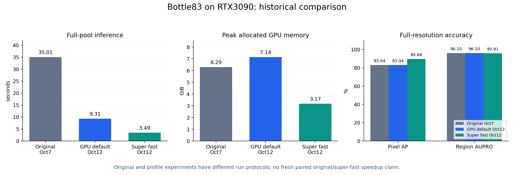

# Super fast backend: historical bottle83 profile-selection report

**Superseded measurement status:** the earlier blocked attempts documented below
were followed by successful fresh-process measurements of bottle83, grid78 and
cable150. See the [current complete category report](CATEGORY_REPORT.md) and
[paired results](category_results.json) for measured original-relative speedups,
memory and all seven accuracy metrics. Grid and cable fail the provisional
accuracy tolerance. The profile-selection evidence below remains historical.

## Result and evidence status

The optional `super_fast` profile is implemented and its packaged outputs are
validated against the selected research candidate on all 83 bottle images.
It uses layer `[5]` (zero-based), `r_list=[3]`, and a 28x28 scoring grid.
The default remains `gpu`. This profile is approximate and changes predictions.

Two complete-pool profile sweeps measured **3.608351s / 3.371212s** versus
default GPU **9.502318s / 9.113942s**, with gains **2.633424x / 2.703461x**.
Peak allocated memory was **3.170 GiB** versus default GPU **7.137 GiB**.
All measured accuracy losses versus default were below the provisional one
percentage point limit; region AUPRO fell 0.197539pp and all other metrics rose.

**Fresh paired original-versus-super-fast measurements are not available.**
The attempt stopped before starting any CUDA worker because required process
inventory was denied. Local-model residency checking was also denied socket
access in the current sandbox. These checks were preserved, not waived.
The historical original comparison below is from a different experiment and
does not establish a paired original-relative speedup or an exact-contract10x
result. [Blocked attempt receipt](blocked_comparison.json).



## Profile implementation

The encoder remains CLIP ViT-L-14-336/OpenAI at 518px, with batch4 loading and
all 24 transformer blocks executed for the pooled class representation used by
RsCIN. Only the sixth block's patch features are selected. LNAMD operates with
radius3 on the original37x37 lattice, then FP32 adaptive average pooling reduces
the aggregated features to28x28. Values return to the feature dtype before
channel normalization. The scoring stage receives784 instead of1369 patches.

All83 images remain in one complete reference pool. The accepted attention
softmax/stores, ordered loading, direct pooling, centered scoring certificates,
FP32 scoring inputs, float64 outputs, per-reference-image Euclidean minima,
self exclusion, trimmed ranks, caller stream, interpolation and RsCIN remain
active. Labels and masks enter only post-inference evaluation. Features are
fresh on every call; the per-division normalization cache never crosses calls.

## Measured inference and memory

RTX3090, PyTorch2.7.1+cu118/CUDA11.8. The two profile passes are forward and
reverse sweeps across11 configurations. No discarded image warmup. Shared
first-use compilation/setup occurs in the initial default inference; later
profiles reuse compiled code but never image features. The second-sweep gain
does not rely on a cold baseline. These are bracketed sweeps, not adjacent
individual baseline/candidate pairs or fresh processes per profile.

|Profile sweep|Pass1 seconds|Pass2 seconds|Median seconds|Peak allocated GiB|Image AUROC|Pixel AUROC|Pixel AP|Region AUPRO|
|---|---:|---:|---:|---:|---:|---:|---:|---:|
|Default gpu|9.502318|9.113942|9.308130|7.137|99.921%|98.477%|83.041%|96.103%|
|super_fast|3.608351|3.371212|3.489782|3.170|100.000%|99.282%|89.683%|95.905%|

The median time reduction is62.51% versus default GPU in the profile study;
peak allocated memory falls55.58%. Allocated memory is live tensor allocation,
not total system/GPU usage. Profile reserved-memory peaks were not captured,
so none are inferred. Model loading, imports, metric evaluation and output
serialization are separate. Applicable first-use setup, decoding, preprocessing,
transfers, encoder, LNAMD/pooling, scoring, interpolation and RsCIN are included
in actual inference time. No component ratio is presented as end-to-end speedup.

### Historical original MuSc context

The October7 original/GPU benchmark starts each backend/pass in a fresh process,
includes first-use setup and uses two alternating pairs on this complete pool.
Its original inference times are35.101958s/34.925246s, median35.013602s.
Original peak allocated memory is6443.120MiB(6.292GiB), and peak reserved memory
is7794MiB(7.611GiB). The October12 profile measurements use resident model
weights and sweep-order compiled-code reuse. Therefore no original/super_fast
speedup ratio is claimed from these separate protocols.

|Separate historical experiments|Median inference|Peak allocated|Peak reserved|Source|
|---|---:|---:|---:|---|
|Original MuSc, October7|35.014s|6.292GiB|7.611GiB|[original/GPU receipt](../representative/results.json)|
|Default gpu, October12 profile sweep|9.308s|7.137GiB|Not captured|[profile receipt](tradeoff_results.json)|
|super_fast, October12 profile sweep|3.490s|3.170GiB|Not captured|[profile receipt](tradeoff_results.json)|

The table gives actual recorded measurements, not a new paired comparison.
[historical_context.json](historical_context.json) records extraction and source
hashes without rewriting the original benchmark evidence.

## Full-resolution accuracy tradeoffs

Metrics use all original518px masks and interpolated maps. Threshold-maximized
F1 is descriptive benchmark performance, not a deployed threshold. Region
AUPRO uses the upstream200 global thresholds at FPR<0.3, implemented through
exact sorted searches; CPU equivalence preflight matches upstream at1e-12.
AP uses the sklearn precision-recall curve definition. Published original
values are from the historical experiment; default/fast share the profile study.

|Metric|Historical original|Default gpu|super_fast|Fast minus default|
|---|---:|---:|---:|---:|
|Image AUROC|99.9206%|99.9206%|100.0000%|+0.0794pp|
|Image AP|99.9752%|99.9752%|100.0000%|+0.0248pp|
|Image best F1|99.2126%|99.2126%|100.0000%|+0.7874pp|
|Pixel AUROC|98.4775%|98.4775%|99.2819%|+0.8045pp|
|Pixel AP|83.0413%|83.0413%|89.6834%|+6.6421pp|
|Pixel best F1|79.1638%|79.1638%|83.6851%|+4.5214pp|
|Region AUPRO|96.1027%|96.1027%|95.9052%|-0.1975pp|

The provisional1pp limit was proposed for this study, not supplied as a customer
acceptance criterion. Both AUROC-only and all-metrics gates are recorded in
JSON. Output changes are much larger than the default2e-5 numerical tolerance:
maximum map difference0.429956, maximum score difference0.396888 versus default.
Existing operational thresholds need separate calibration. Bottle83 is a
retrospective selected benchmark; accuracy improvements do not establish
unseen-image, other-category, other-backbone or other-GPU generalization.

## Selection of the one-layer preset

Each of the four default feature layers was tested individually on19x19 and
28x28 grids with r_list=[3], alongside default and3-layer controls. Every
configuration received two complete inference calls. Repeated maps/scores were
bitwise identical. Layer5 was the only single-layer selection that met the
broader1pp bound on both grids. The28-grid was chosen for closer region accuracy
than19-grid at a small latency cost. This is not an exhaustive hyperparameter
search or proof that layer5 is optimal on other categories.

|Scoring grid|Zero-based layer|Median seconds|Image AUROC|Pixel AP|Region AUPRO|All metrics within1pp of default?|
|---|---:|---:|---:|---:|---:|---|
|28x28|5|3.490|100.000%|89.683%|95.905%|Yes|
|28x28|11|3.450|99.921%|84.810%|95.057%|No|
|28x28|17|3.427|99.206%|71.299%|92.191%|No|
|28x28|23|3.462|97.857%|54.777%|84.399%|No|
|19x19|5|3.360|100.000%|89.948%|95.198%|Yes|
|19x19|11|3.309|99.921%|84.695%|94.147%|No|
|19x19|17|3.389|99.365%|71.313%|92.008%|No|
|19x19|23|3.489|98.968%|56.157%|85.196%|No|

## Packaged integration and regression checks

[integration.json](integration.json) records the actual public `MuSc`
constructor/backend dispatch, with one full default call followed by two full
super_fast calls. Default outputs match saved default predictions bit-for-bit;
super_fast outputs match the selected candidate and each other bit-for-bit.
Model weights are resident but image features are recomputed. Integration
times9.499724s/3.316748s/3.319948s are retained as correctness-run diagnostics,
not a new paired speedup claim. Source hashes bind the receipt to the package.

CPU tests verify configuration isolation, fixed preset selection, rejection of
unsupported backbone/weights/resolution/batch/division settings, unchanged
original/GPU choices, platform/CPU fallback, pooling arithmetic and independent
aggregation factories. The release verifier checks packaged hashes, unchanged
CUDA kernels, historical evidence, fresh integration and local documentation
links. The comparison runner adds tests for exactPRO, actual paired ratios,
median timing, memory changes, metric percentage points and input identity.

## Usage and reproduction

```
python examples/musc_main.py --data_path C:/path/to/mvtec_anomaly_detection --class_name bottle --inference_backend super_fast
python tools/test_super_fast.py
python tools/test_super_fast_benchmark.py
python tools/verify_release.py
```

The fixed preset overrides feature layers/r_list. It requires native Windows
CUDA for acceleration, ViT-L-14-336/OpenAI at518px, batch4 and divide_num1.
CPU/unsupported-platform requests fall back to original with the caller's
original layers/radii. Runtime CUDA errors remain explicit. Default `gpu`
and `original` remain selectable and retain their numerical contract.

### Pending fresh original comparison

Run with process/model inspection permissions, after coordinating GPU access:

```
python tools/benchmark_super_fast.py --data-path C:/path/to/mvtec_anomaly_detection --output output/super_fast_comparison
```

The standalone runner plans the complete83-image bottle pool, acquires research
and GPU leases, checks processes/unloaded local models, and starts four fresh
bounded workers in original/fast then fast/original order. Windows Job Objects
own worker process trees; timeouts preserve receipts and terminate only owned
workers. All metrics, allocated/reserved peaks, setup scope, source hashes,
prediction differences, repeated-call checks and actual paired speedups are
recorded. It evaluates an approximate accuracy gate instead of rejecting the
intentional map changes under2e-5. A new output directory preserves prior runs.
Use `--plan-only` for CPU planning, and `--coordinator-status PATH` when running
under an external research coordinator. No GPU work starts if checks fail.

## Artifact index

- [Raw profile receipt](tradeoff_results.json): all11 configurations,22 full
  calls, commands, environment, paths, hashes, timing, errors, memory and metrics.
- [Profile summary](tradeoff_summary.json): same-grid controls and both gates.
- [Packaged integration](integration.json): full-pool source/output equivalence.
- [Historical context](historical_context.json): original measurements/provenance.
- [Blocked fresh comparison](blocked_comparison.json): zero pairs and traceback.
- [Comparison figure, PNG](comparison.png) and [SVG](comparison.svg).

All completed GPU work was serialized with coordination/unload checks. No
dataset or historical report was altered. No original-contract10x achievement,
fresh paired original-relative result, or other-category accuracy qualification
is claimed by this report.

## Grid and cable follow-up attempt

The complete grid78 and cable150 pools were planned for two alternating fresh-process
original/super-fast pairs each. Both coordinators failed the required Windows process
inventory (`Get-CimInstance Win32_Process`: access unavailable) before CUDA,
mutex acquisition or any timed worker. Neither pool has new latency, memory or
accuracy measurements. The graph therefore retains its missing-data labels.

[Authoritative failed-attempt receipt](blocked_categories.json).
The runner now accepts `--categories bottle grid cable` and keeps each category
as a separate complete reference pool. The graph must only be replaced after
successful measured trials; no timings are extrapolated from bottle.
